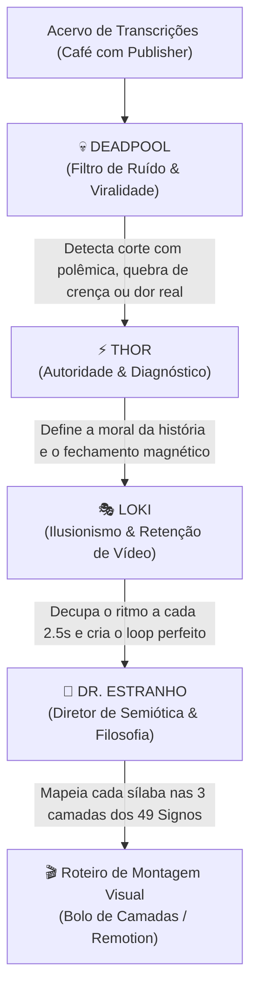

# 🏛️ MEMÓRIA OFICIAL: SEMIÓTICA VISUAL, CURADORIA FILOSÓFICA & CORTES VIRAIS PUBX

*Data de Registro:* 20/11/2026  
*Status:* 🟢 HOMOLOGADO • ARQUITETURA AGÊNTICA DE DUPLA FASE E LÉXICO DOS 49 SIGNOS VISUAIS  
*Base de Conhecimento:* Acervo dos Cafés com Publisher (~6.300.000 caracteres, 79+ episódios), Metodologia Bolo de Camadas (@soupiva) e Matriz de Heróis (Thor, Deadpool, Loki, Dr. Estranho).

---

## 1. VISÃO GERAL & TESE CENTRAL

Vídeos verticais e cortes de alta performance (Reels/Shorts/TikTok) para o ecossistema PubX **não operam por associação literal rasa**. 
Quando um locutor fala *"ganhei dinheiro e perdi tudo"*, uma IA genérica insere um cifrão e um gráfico vermelho. O ecossistema PubX opera por **Semiótica de Dupla Camada e Tripla Interpretação**:

1. **Mineração do Corte de Ouro:** Extração de trechos densos, com tensão, polêmica, dor visceral ou quebra de crença.
2. **Decupagem Semiótica em 3 Níveis:** Cada momento da fala é analisado no nível **Literal**, **Conceitual** e **Filosófico**.
3. **Léxico Fechado de 49 Signos Visuais:** Todo elemento visual do card central é obrigatoriamente convocado a partir do acervo das **duas imagens oficiais** (holográficas, raio-X/dither pontilhado, paleta Onyx Black `#050507`, Dourado Neon `#FFC700`, Verde Sucesso `#10B981` e Vermelho Alerta `#EF4444`).

---

## 2. O LÉXICO OFICIAL DOS 49 SIGNOS VISUAIS DO PUBLISHER

### 🖼️ IMAGEM 1: CENÁRIOS, SITUAÇÕES, EMOÇÕES & METÁFORAS FILOSÓFICAS (21 SIGNOS)

```text
[L1C1] Home Office na Madrugada (Quarto escuro, luminária, lua na janela, xícara na mesa)
[L1C2] Palco & Auditório PubX (Plateia de costas, palco com telão de dados iluminado)
[L1C3] Globo Terrestre com Anel Orbital (Alcance global de tráfego, liberdade geográfica)
[L2C1] Racks de Servidores no Data Center (A sala de máquinas, infraestrutura inquebrável)
[L2C2] Janela Web com Barra de Loading / Refresh (O F5 compulsivo, a ansiedade da telemetria)
[L2C3] Janela com Checkmark & Sino (Aprovação de site no AdSense, notificação de vitória)
[L3C1] Janela com Alerta Vermelho de Bloqueio 🚫 (Suspensão de conta no Meta/AdSense, ad limit)
[L3C2] Chave Dourada na Fechadura (A virada de chave mental, o desbloqueio do método)
[L3C3] Pilhas de Moedas com Seta Ascendente (Escala progressiva de capital, lucro acumulado)
[L4C1] Funil Invertido de Notas para Moedas (Filtro de tráfego desordenado virando lucro puro)
[L4C2] Coroa Real Dourada (A soberba do publisher novato, o topo frágil de quem acha que sabe tudo)
[L4C3] Notebook com Cascata de Documentos (Obesidade de informação, paralisia mental por excesso)
[L5C1] Olho de Scanner / Visão Raio-X em Imagem (O olhar clínico dissecando criativos de anúncio)
[L5C2] Escudo Metálico com Cifrão Dourado (Blindagem patrimonial, operação de margem segura)
[L5C3] Prancheta com Checklist & Caneta (Planejamento estratégico, método passo a passo)
[L6C1] Manequim Subindo Degraus com Seta (Jornada de evolução e maturidade operacional)
[L6C2] Rede de Manequins Conectados (Networking real entre sócios e comunidade Kaizen)
[L6C3] Castelo de Cartas Desmoronando (Dependência do orgânico, terreno alugado ruindo)
[L7C1] Galinha Dourada Correndo (O "Voo de Galinha", lucro efêmero por sorte sem consistência)
[L7C2] Três Engrenagens Mecânicas (Conteúdo, Tráfego e Monetização rodando em harmonia)
[L7C3] Foguete em Decolagem de Alta Propulsão (A escala agressiva com controle milimétrico)
```

---

### 🖼️ IMAGEM 2: OBJETOS TÉCNICOS, ADTECH, MÉTRICAS & INFRAESTRUTURA (28 SIGNOS)

```text
[L1C1] Xícara de Café Fumegante (O ritual matinal do Café com Publisher)
[L1C2] Manequim Operando 3 Telas (O operador de mídia e tráfego na trincheira)
[L1C3] Wireframe de Página Web / Artigo (A estrutura do post com blocos marcados)
[L1C4] Triângulo de Advertência ⚠️ (Alerta de compliance, risco de penalização)
[L2C1] Botão com Cursor de Clique (A ação do usuário, o clique qualificado)
[L2C2] Velocímetro com Agulha no Máximo (PageSpeed, carregamento instantâneo)
[L2C3] Escudo com Robô Barrado (Proteção contra tráfego inválido e bots)
[L2C4] Cifrão em Dólar 3D (Faturamento em moeda forte)
[L3C1] Moeda de Dólar Redonda (O valor unitário do clique / CPC)
[L3C2] Maço de Cédulas Dourado (Faturamento acumulado em lote)
[L3C3] Funil com Notas Entrando (A esteira de monetização)
[L3C4] Dashboard com Gráfico de Barras e Pizza (Visão panorâmica de Analytics)
[L4C1] Gráfico de Linha com Pin de Localização (Telemetria com momento de virada)
[L4C2] Cursor de Mouse com Símbolo % (Taxa de cliques / CTR)
[L4C3] Marcador Analógico de RPM (Receita por Mil Impressões)
[L4C4] Tag de eCPM com Seta para Cima (Aumento do lance pago pelos anunciantes)
[L5C1] Pílulas de Dados / Segmentação (A divisão de públicos e criativos em teste)
[L5C2] Múltiplos Servidores com Feixe Luminoso (A infraestrutura em nuvem distribuída)
[L5C3] Martelo de Leilão (O leilão em tempo real / RTB do Google Ad Manager)
[L5C4] Smartphone com Anúncio Intersticial (A monetização em tela cheia na transição)
[L6C1] Janela Modal com Botão OK (Confirmação de ação ou opt-in)
[L6C2] Mapa de Calor (Heatmap) na Página (Zonas de atenção e permanência do leitor)
[L6C3] Sliders de Equalização (Ajuste fino de regras de preço e lances)
[L6C4] Paginação de Página `< 1 2 >` (O funil de P1 para P2)
[L7C1] Tag de Código `</>` (Implementação técnica e scripts de tracking)
[L7C2] Logo Meta Infinito (Tráfego pago via Facebook e Instagram Ads)
[L7C3] Logo AdSense Estilizado (Monetização programática do Google)
[L7C4] Sino de Push com Badge de Notificação (Audiência própria via web push)
```

---

## 3. AS TRÊS CAMADAS DE INTERPRETAÇÃO SEMIÓTICA

O agente analisa cada fala em **3 camadas simultâneas**, escolhendo a mais profunda e potente para cada frase:

### 1ª Camada: Literal (O que a boca fala)
- **Definição:** O locutor cita nominalmente a ferramenta, plataforma ou objeto.
- **Gatilho:** Palavras como "AdSense", "Meta", "clique", "artigo", "servidor".
- **Aplicação:** Usar apenas nos primeiros segundos para situar o espectador ou quando o contexto técnico exigir clareza crua.

### 2ª Camada: Conceitual (A mecânica oculta da operação)
- **Definição:** O locutor descreve uma consequência prática sem citar o mecanismo por trás.
- **Exemplo na fala:** *"Eu trazia 50 mil pessoas por dia e sobrava migalha no final do mês."*
- **Leitura Semiótica:** O problema não é o tráfego, é a retenção e o ralo de monetização.
- **Signo Convocado:** `[L4C1-Img1 Funil Invertido de Notas]` ou `[L6C2-Img2 Mapa de Calor com zona fria]` ou `[L4C3-Img2 Marcador Analógico de RPM no zero]`.

### 3ª Camada: Filosófica & Subtextual (A psicologia, o arquétipo e a lição)
- **Definição:** O locutor expressa arrogância, dor, solidão, alívio, resiliência ou sabedoria de trincheira.
- **Exemplo 1 (Soberba / Falso Sucesso):** *"Achei que tava rico porque fiz 20k no primeiro mês."*  
  $\rightarrow$ Signo: `[L7C1-Img1 Galinha Dourada ("Voo de Galinha")]` ou `[L4C2-Img1 Coroa Real]`.
- **Exemplo 2 (Terreno Alugado / Fragilidade):** *"Minha vida dependia do Discover e do nada acabou tudo."*  
  $\rightarrow$ Signo: `[L6C3-Img1 Castelo de Cartas Desmoronando]`.
- **Exemplo 3 (Solidão & Luta):** *"Eu ficava até as 4h da manhã tentando entender onde tava errando."*  
  $\rightarrow$ Signo: `[L1C1-Img1 Home Office na Madrugada com a lua na janela]`.
- **Exemplo 4 (Virada de Consciência):** *"Foi quando parei de olhar vaidade e olhei processo."*  
  $\rightarrow$ Signo: `[L3C2-Img1 Chave Dourada na Fechadura]` ou `[L7C2-Img1 Três Engrenagens]`.

---

## 4. O SISTEMA AGÊNTICO DE HERÓIS APLICADO AOS CORTES

Para operar essa inteligência, o fluxo de criação convoca as personas mestras:



1. **💀 Deadpool (O Garimpador de Viralidade):**
   - Varre a minutagem procurando os pontos de atrito (*"Isso que vocês fazem é ilusão"*, *"Eu quebrei 3 vezes antes de entender isso"*, *"SEO puro morreu para quem quer previsibilidade"*).
   - Elimina introduções mornas e conversa de elevador. Corta direto no ápice do conflito.

2. **⚡ Thor (O Guardião da Autoridade):**
   - Garante que o corte tenha peso de publisher sênior.
   - Conecta a dor apresentada à solidez do método PubX (Controle de dados, telemetria e arbitragem profissional).

3. **🎭 Loki (O Engenheiro de Retenção & Loop):**
   - Garante a virada de cabeça nos primeiros 3 segundos (Hook).
   - Define os tempos de troca visual (Hold State de 2 a 3 segundos com micro-ações determinísticas).
   - Costura o final da fala para conectar cirurgicamente de volta ao primeiro segundo (Loop infinito).

4. **🔮 Dr. Estranho (O Decodificador Semiótico):**
   - Assume o roteiro decupado pelo Loki e aplica a **Matriz dos 49 Signos**.
   - Decide onde entra o Literal, onde entra o Conceitual e onde a tela brilha com o Filosófico.

---

## 5. TEMPLATE OFICIAL DE DECUPAGEM SEMIÓTICA (TABELA DE EXECUÇÃO)

Todo corte gerado por esta vertente deve ser entregue na seguinte estrutura:

```markdown
### 🎬 CORTE: [Título Magnético do Corte]
- **Episódio de Origem:** [Ep #XX - Título do Café]
- **Minutagem:** [00:00:00 -> 00:00:50]
- **Tese Central / Conflito:** [Qual a dor ou quebra de padrão abordada]
- **Arquétipo Ativado:** [Thor / Deadpool / Loki]

| Timestamp | Fala Transcrita | Nível Semiótico | Signo Visual Convocado (Código + Nome) | Justificativa Filosófica / Conceitual |
| :---: | :--- | :---: | :--- | :--- |
| **00:00 - 00:03** | "[Frase de gancho]" | Filosófico | [Código da Img 1 ou 2] | [Por que essa imagem evoca o sentimento exato] |
| **00:03 - 00:07** | "[Frase de problema]" | Conceitual | [Código da Img 1 ou 2] | [Qual a mecânica oculta por trás da frase] |
| **00:07 - 00:12** | "[Frase técnica]" | Literal | [Código da Img 1 ou 2] | [A ferramenta ou objeto real citado] |
| **00:12 - 00:18** | "[Clímax / Virada]" | Filosófico | [Código da Img 1 ou 2] | [A metáfora de transformação] |
| **00:18 - 00:25** | "[Desfecho / Loop]" | Conceitual | [Código da Img 1 ou 2] | [A ancoragem de autoridade e fechamento] |
```

---

## 6. DIRETRIZES DE ESTILO PARA NOVAS ILUSTRAÇÕES

Caso uma cena futura exija um signo que não esteja nos 49 atuais, ele DEVE seguir obrigatoriamente a gramática visual unificada:
- **Técnica:** Halftone / dither de pontos raio-X/holográfico, contorno volumétrico de luz (rim light) sobre fundo preto `#050507`.
- **Cores:** Monocromático (prata/branco translúcido) com um único elemento focal em Dourado Neon `#FFC700` (ou Verde `#10B981` para vitória/aprovação, ou Vermelho `#EF4444` para bloqueio/alerta).
- **Enquadramento:** Elemento centralizado dentro de um card de cantos arredondados com textura glass suave.
- **Zero Poluição:** Uma ideia por cena. Sem figurantes ou enfeites vazios.
